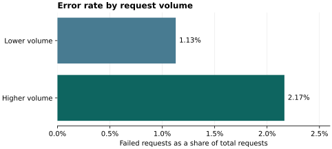

# Does reliability vary with request volume?

James Webb · Continuous Intelligence · November 2026

## Data and question

I used the [10 example observations](https://github.com/denisecase/cintel-03-signal-design/blob/main/data/system_metrics.csv) from Denise Case's signal design project to ask whether failure rates differ between observations with lower and higher request counts. Each row gives requests handled, failed requests, and cumulative response time in milliseconds.

## Success-rate experiment

I predicted that success rate would equal one minus error rate for observations with requests and would be undefined at zero requests. The new signal divides successful requests by total requests. Across the original 10 rows it ranged from 97.50% to 100%, and success rate plus error rate equaled 1 within floating-point precision. A separate zero-request input produced a null success rate.

## Comparing request volumes

I used Polars to split the positive-volume observations at the median of 115 requests. The lower group includes observations at or below 115. The higher group includes observations above 115. I summed requests, errors, and latency within each group. Dividing those totals by total requests gives rates and latency weighted by requests.

| Group | Observations | Requests | Errors | Error rate | Success rate | Average latency |
|---|---:|---:|---:|---:|---:|---:|
| Lower | 5 | 443 | 5 | 1.13% | 98.87% | 29.12 ms |
| Higher | 5 | 785 | 17 | 2.17% | 97.83% | 30.70 ms |

## Interpretation and next steps

The higher-volume group had about 1.9 times the error rate and 1.58 ms higher average latency. This sample contains ten observations and lacks timestamps and a request-type breakdown. The comparison describes an association in these rows. With more data, I would compare equal-duration intervals and separate request types to see whether the pattern persists.

## Run and inspect the project

- [README and run instructions](https://github.com/jrwebb7/cintel-03-signal-design-custom#run-the-project)
- [Row-level signals](https://github.com/jrwebb7/cintel-03-signal-design-custom/blob/main/artifacts/signals.csv)
- [Group comparison CSV](https://github.com/jrwebb7/cintel-03-signal-design-custom/blob/main/artifacts/volume_comparison.csv)
- [Course workflow guide](https://denisecase.github.io/pro-analytics-02/)
